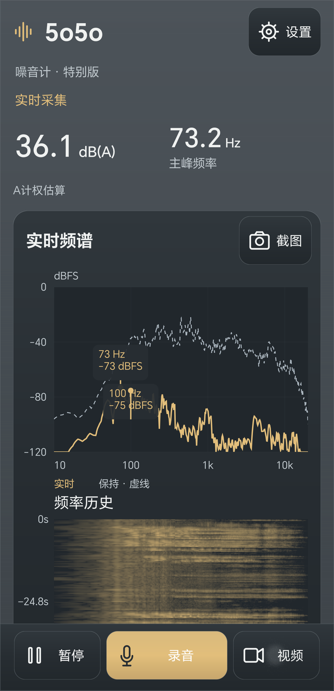
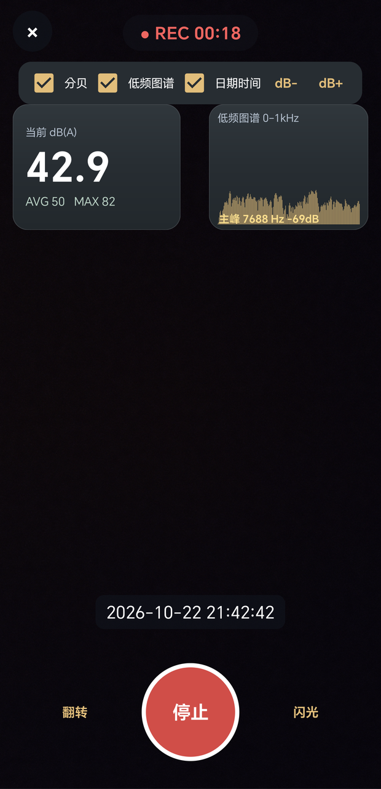

# 5o5o Noise Meter

[English](README.md) | [简体中文](README.zh-CN.md)

**See sound. Record changes. Keep the context.**

5o5o Noise Meter is an Android app for real-time sound level estimation, spectrum analysis, and spectrogram visualization. Capture screenshots, record WAV audio, and save on-site videos with sound level, low-frequency spectrum, and timestamp overlays.

Use it to observe recurring hums, document changes over time, and compare recordings made at different locations under consistent conditions.

**Version:** 1.7 · **Platform:** Android · **Website:** [www.5o5o.com](https://www.5o5o.com/)

[Download](#download) · [Screenshots](#screenshots) · [Quick Start](#quick-start) · [Saved Files](#saved-files) · [License](#license)

## Features

- **A-weighted sound level estimates:** Observe overall changes using dB(A) readings and an adjustable calibration offset.
- **Real-time spectrum:** View the relative strength of frequency components and identify the dominant frequency.
- **Frequency history:** Use the spectrogram to observe persistent tones, intermittent sounds, and repeated starts and stops.
- **Pinch-to-zoom:** Inspect the home-screen spectrogram in greater detail.
- **PNG screenshots:** Save the current display for later review or comparison.
- **WAV audio recording:** Keep an audio record alongside your observations.
- **Video with overlays:** Choose sound level, low-frequency spectrum, and date and time overlays, then save a portrait MP4 at 720 × 1280 pixels.
- **Visual themes:** Choose Special Edition, Professional Edition, or Fluorescent Professional Edition.
- **Local storage:** Captured screenshots, audio, and videos remain on your phone.

## Screenshots

<table>
  <tr>
    <th>Real-time Spectrum and Frequency History</th>
    <th>Video Recording with Overlays</th>
  </tr>
  <tr>
    <td align="center"></td>
    <td align="center"></td>
  </tr>
</table>

The screenshots show the Chinese-language interface. Readings and timestamps are examples from the captured screens.

## Download

| Source | Link | Details |
| --- | --- | --- |
| **GitHub — recommended** | [yuhuashiziji/5o5onoisemeter](https://github.com/yuhuashiziji/5o5onoisemeter) | Check the repository for available versions and downloads. |
| Official website | [Download version 1.7 APK](http://www.5o5o.com/5o5ozyj/5o5o_noise_meter-1.7.apk) | Direct Android installation package. |
| Baidu Netdisk | [Open download page](https://pan.baidu.com/s/1ZQJsw9rmTzlJUGoBO1_LIg?pwd=5a93) | Extraction code: `5a93` |
| Lanzou Cloud | [Open download page](https://wwall.lanzouu.com/iW2ZH4d7pcda) | Password: `awb4` |

If Android requests permission to install the APK, allow installation for the browser or file manager you are using, then follow the system prompts.

### Upgrading from an Earlier Version

Back up important recordings first. Install the update over the existing app when the package name and signing identity match. If Android reports a signature conflict or “App not installed,” confirm the package source before uninstalling the old version or clearing its data.

After upgrading, check microphone and camera permissions, your selected theme, and the calibration settings.

## Quick Start

1. **Grant microphone permission.** Camera permission is needed when opening video mode. Older Android versions may also request storage permission.
2. **Position the phone.** Keep microphone openings unobstructed and minimize handling noise, nearby speech, and wind.
3. **Observe for a few seconds.** Check the sound level estimate, dominant frequency, spectrum, and frequency history.
4. **Save a record.** Choose Screenshot, Record Audio, or Video according to what you need to document.

Opening the app does not automatically save an audio recording. Opening video mode starts a preview; tap **Start** to begin recording.

## Understanding the Display

| Display | What It Means |
| --- | --- |
| **dB(A)** | An A-weighted sound level estimate with the configured calibration offset applied. |
| **Dominant frequency, Hz** | A frequency currently standing out in the analyzed spectrum. |
| **Real-time spectrum, dBFS** | The relative digital signal level at different frequencies. |
| **Frequency history / spectrogram** | Frequency content displayed over time, with color representing relative strength. |

**dBFS and dB(A) describe different quantities and do not need to match.** A-weighting reduces the contribution of low frequencies to the overall reading. When observing a low-frequency hum, examine the spectrum and retain an audio recording as well.

The home screen and video mode share the A-weighting calculation and calibration offset. Their instantaneous readings can still differ because they sample at different times.

The small spectrum in video mode displays **0–1 kHz**, while dominant frequency selection uses the full analyzed frequency range. A dominant frequency above 1 kHz may therefore fall outside the small chart.

## Recording Tips

### Screenshots

Wait for the display to stabilize, then tap **Screenshot**. You can pause the display before capturing it and resume afterward.

### Audio

Tap **Record Audio** to begin, then **Stop** to finish. Wait for saving to complete before starting another recording.

**Pausing the display does not stop audio recording.** Keep the app in the foreground for continuous recording; changing screens or moving the app to the background may end and save the current segment.

### Video

1. Open **Video** and check the framing and orientation.
2. Select the overlays you want to include.
3. Tap the red **Start** button and keep the phone steady.
4. Tap the circular button again to stop, then wait for saving to finish.

Switching cameras during recording saves the current clip and starts a new one, so a session may produce multiple files. Flash availability depends on the selected camera.

The **dB+** and **dB−** controls adjust the shared calibration offset by **2 dB per tap**. Avoid changing them unintentionally after calibration.

## Saved Files

| File Type | Internal Storage Folder | Format |
| --- | --- | --- |
| Screenshots | `Pictures/5o5o噪音计` | PNG |
| Audio recordings | `Music/5o5o噪音计` | WAV |
| Videos | `Movies/5o5o噪音计` | MP4 |

Folder names above are shown exactly as they appear on the device. File names usually begin with `5o5o_`; search for this prefix in your file manager if needed.

Use the system gallery or file manager to share, rename, and organize recordings.

## Version 1.7 Highlights

The changes accumulated between versions 1.5 and 1.7 include:

- A clearer Special Edition home screen and coordinated visual themes.
- Consistent sound level and dominant frequency calculations across the home screen and video mode.
- Video preview before recording, selectable overlays, and fixed portrait MP4 output.
- App watermarks on exported screenshots and videos.
- Improvements to microphone and camera resource handling, recording finalization, file saving, and error handling.

Not every improvement was first introduced in version 1.7; this list summarizes the cumulative update period.

## Measurement and Compatibility Notes

Phone microphones and audio processing vary between devices. The app is intended for observation, documentation, and comparison; it does not replace a calibrated professional sound level meter.

- Recheck calibration when changing phones or recording configurations.
- A calibration made in one environment does not make the reading constant elsewhere.
- For meaningful comparisons, keep the position, orientation, settings, and observation conditions consistent.
- Frequency and dB(A) readings alone cannot determine a sound source's identity, direction, or distance.
- Version 1.7 testing covered the main workflows on one HONOR phone running Android 16. Compatibility may vary on other devices.

## Troubleshooting

**The reading is not changing.** Check whether the display is paused, confirm microphone permission, and close other apps using the microphone.

**The video preview is black.** Check camera permission and whether another app is using the camera. Save your current recording before reopening video mode.

**Saving takes time.** The app needs to finalize the recording and write the file. Wait for completion before starting another operation.

**Saving fails.** Check available storage and permissions, and retain the error message. Avoid immediately uninstalling the app or clearing its data, as temporary recordings may still be stored there.

## Privacy

All captured data is stored locally on the device and is not uploaded to a server. Files are shared when you choose to share them using the system gallery, file manager, or another app.

## License

5o5o Noise Meter is free for personal use under the **Free Use with Attribution Required** terms. Attribution to **“雨花石子记” (Yuhua Shizi Ji)** must be retained.

Commercial use, repackaging after removing copyright notices, reverse engineering, and cracking are prohibited. See `LICENSE.txt` for the full terms.

## Support

Visit [www.5o5o.com](https://www.5o5o.com/) for product information and usage guides.

When reporting a problem, include the app version, phone model, Android version, steps to reproduce it, and the complete error message. Remove personal information from screenshots before sharing them.
