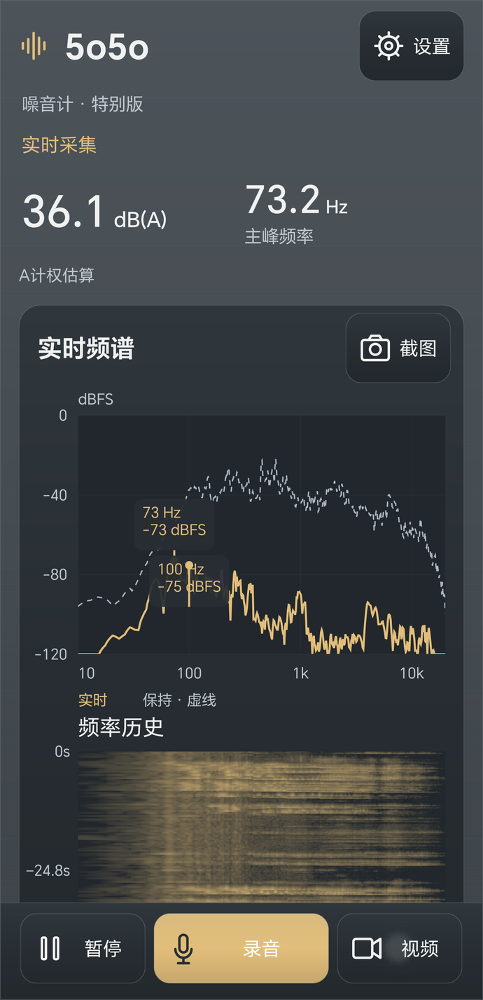
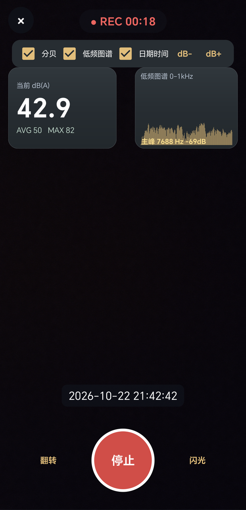

# 5o5o噪音计

[English](README.md) | [简体中文](README.zh-CN.md)

**把声音看清，把变化留下。**

5o5o噪音计是一款用于观察声音频率、记录噪声变化和保留现场资料的安卓应用。通过实时声级估算、频谱、频率历史、截图、WAV录音和带读数的现场录像，帮助你比较不同时间、不同位置的声音变化。

适合观察反复出现的嗡声、记录设备启停前后的变化，以及在尽量一致的条件下留存可供回看的现场资料。

**版本：** 1.81（应用内 1.8.1） · **平台：** Android · **官网：** [www.5o5o.com](https://www.5o5o.com/)

[下载安装](#下载安装) · [界面预览](#界面预览) · [快速上手](#快速上手) · [文件保存位置](#文件保存位置) · [许可](#许可)

## 主要功能

- **A计权声级估算：** 查看dB(A)读数，结合校准偏移观察整体变化。
- **实时频谱：** 观察不同频率的相对强弱，查看当前主峰频率。
- **频率历史与瀑布图：** 回看声音是否持续、间歇出现或反复启停。
- **双指缩放：** 放大首页瀑布图，仔细查看频率历史。
- **PNG截图：** 保存当前界面，方便回看和对比。
- **WAV录音：** 为观察过程留下声音记录。
- **带叠加信息的录像：** 按需显示分贝、低频图谱和日期时间，导出720 × 1280竖屏MP4。
- **多种配色主题：** 专业版与特别版。
- **本机保存：** 截图、录音和录像保存在手机中。

## 界面预览

<table>
  <tr>
    <th>实时频谱与频率历史</th>
    <th>带分贝、图谱和时间的录像</th>
  </tr>
  <tr>
    <td align="center"></td>
    <td align="center"></td>
  </tr>
</table>

以上为此前版本的真实界面示例，读数、时间和局部样式不代表当前测量结果或1.81全部界面。

## 下载安装

**下载、使用与更新免费。最新发布版为 1.81，应用内显示 1.8.1。**

- **[直接下载安卓 APK](https://github.com/yuhuashiziji/5o5onoisemeter/releases/download/v1.8.1/5o5o_noise_meter-1.8.1.apk)**
- [1.81 更新说明与全部附件](https://github.com/yuhuashiziji/5o5onoisemeter/releases/tag/v1.8.1) · [最新版本](https://github.com/yuhuashiziji/5o5onoisemeter/releases/latest)
- [详细使用说明书（中文）](https://github.com/yuhuashiziji/5o5onoisemeter/releases/download/v1.8.1/USER-GUIDE-1.81.md)
- [SHA-256 校验清单](https://github.com/yuhuashiziji/5o5onoisemeter/releases/download/v1.8.1/SHA256SUMS-v1.8.1.txt)

安装只需下载 APK；GitHub 自动提供的“Source code”压缩包不是安装包，也不代表本地最新私有源码。支持 Android 5.0 及以上；录像能力取决于设备。若系统提示，请允许当前浏览器或文件管理器安装应用。

发布版不包含独立分析包版的“专业模式分析包”和“精密观测版”主题。官网与网盘资料可能存在更新延迟，请以本页 GitHub Release 为准。

### 从旧版本升级

先备份重要记录。包名和签名身份一致时，优先覆盖安装，不要为了升级先卸载或清除数据。

若出现“应用未安装”或签名冲突，请先确认安装包来源与升级方式。升级后检查麦克风、相机权限，以及主题和校准设置。

## 快速上手

1. **允许麦克风权限。** 首次进入视频时再允许相机权限；旧版Android如询问存储权限，也需要允许才能保存文件。
2. **固定手机位置。** 不要遮挡麦克风孔，尽量减少手部摩擦、说话和风吹手机的干扰。
3. **等待几秒再观察。** 同时查看声级估算、主峰频率、实时频谱与频率历史。
4. **根据需要保存。** 选择截图、录音或视频，留下这次观察的记录。

打开应用不代表已经开始保存录音；进入视频页面先预览，点击“开始”才正式录像。

## 看懂读数和图谱

| 显示内容 | 含义 |
| --- | --- |
| **dB(A)** | 经过A计权处理并叠加校准偏移后的声级估算。 |
| **主峰频率Hz** | 当前分析频谱中比较突出的频率成分。 |
| **实时频谱dBFS** | 不同频率对应的相对数字信号电平。 |
| **频率历史／瀑布图** | 按时间显示频率分布，用颜色表示相对强弱。 |

**dBFS和dB(A)含义不同，不需要数值相等。** A计权会降低低频在整体读数中的权重，观察低频嗡声时应同时查看频谱，并保留录音。

首页和视频使用相同的A计权算法与校准偏移，但采样时间不同，环境变化仍可能让瞬时数字不同。

视频中的低频小图只显示 **0–1 kHz**；主峰选择覆盖完整分析频段，因此主峰高于1 kHz时，标注不一定落在小图显示范围内。

## 记录方法

### 截图

显示稳定后点“截图”。需要仔细查看时，可以先暂停显示，截图后再继续。

### 录音

首页点“录音”开始，点“停止”结束，等待保存完成再开始下一段。

**暂停显示不会停止录音。** 连续录音时请保持应用在前台；进入其他页面或切到后台，可能结束并保存当前片段。

### 录像

1. 点“视频”，先检查取景和画面方向。
2. 按需要勾选分贝、低频图谱和日期时间。
3. 点红色“开始”，出现录制状态后保持手机稳定。
4. 再次点圆形按钮结束，等待保存完成。

“翻转”切换前后镜头；录制中切换会保存当前片段，再开始新片段，因此可能得到多个视频文件。“闪光”是否可用取决于当前镜头。

“dB+”和“dB−”每次调整 **2 dB**，与首页共用校准偏移。校准完成后不要随意调整。

## 文件保存位置

| 文件 | 手机内部存储文件夹 | 格式 |
| --- | --- | --- |
| 截图 | `Pictures/5o5o噪音计` | PNG |
| 声音录音 | `Music/5o5o噪音计` | WAV |
| 现场录像 | `Movies/5o5o噪音计` | MP4 |

文件名通常以 `5o5o_` 开头。找不到时，可在系统文件管理器中搜索这个前缀；分享、重命名和分类整理可通过系统相册或文件管理器完成。

## 1.81 更新重点

- 新增持续视频监测，低清、目标 5 fps，持续保存现场声音与画面。
- 疑似敲击、连续冲击自动标记，支持手动标记和按事件回放。
- 视频与事件信息可导出 ZIP；精简导出元数据，不保留检测器内部诊断字段。
- 持续监测采用特别版的铁灰配色；更新八爪鱼图标。
- 修复停止后重新开始的会话交接，以及相机预览遮挡监测菜单的问题。
- 哨兵模式为测试功能，说明书介绍测试范围，不公开测试入口。

### 持续视频监测怎么用

1. 首页“设置”菜单选择“持续视频监测”，检查取景方向和剩余空间。
2. 点击“开始监测”，确认“持续录像中”和计时变化。
3. 听到重要声音时可补充“手动标记”。自动标记仅为异常候选，可能误报或漏报，不是声源鉴定。
4. 点击“停止并保存”，等待完成后，从右上角菜单查看事件回放或“导出视频与事件ZIP”。

右上角菜单可翻转摄像头或收起预览。收起预览不等于停止录像。此模式持续录像，采用低亮常亮，使用时保持页面运行；不是只在异常时才录像，也不承诺锁屏整夜稳定。保存的视频优先用于记录，不适合观察快速动作细节。监测 ZIP 包含现场音视频，分享前注意隐私。

## 测量与兼容性说明

实时dB(A)是平滑声级估算，不是整段测量的严格LAeq。

不同手机的麦克风和音频处理存在差异。本应用适合观察、记录和比较变化，不能替代经校准的专业声级计。

- 更换手机或采集配置后，应重新核对校准。
- 在某一环境校准过，不代表其他环境应显示相同读数。
- 比较前后记录时，尽量统一位置、朝向、设置和观察条件。
- 不能仅凭频率和dB(A)确定声源身份、方向或距离。
- 1.81已完成部分单机短时检查；最新构建尚未覆盖全部回归、整夜监测及系统中断场景，其他设备可能存在兼容差异。

## 常见问题

**数字不动怎么办？** 检查是否暂停显示、是否允许麦克风权限，并关闭其他占用麦克风的应用。

**视频黑屏怎么办？** 检查相机权限和其他应用是否占用相机，先保存已有记录，再重新进入视频页面。

**为什么停止后还要等？** 应用需要完成音视频收尾与文件写入，保存完成后再进行下一次操作。

**保存失败怎么办？** 检查存储空间与权限，保留错误信息。不要立即卸载或清除数据，以免删除应用中仍暂存的记录。

## 隐私

所有采集数据仅保存在手机本机，不上传服务器。通过系统相册、文件管理器或其他应用分享文件时，由你自行选择分享。

## 许可

本应用供个人免费使用，采用 **“免费使用但保留署名”** 条款，须保留 **“雨花石子记”** 署名。

禁止商用、移除版权标识后二次打包、反向分析与破解。完整条款详见 `LICENSE.txt`。

## 使用支持

访问 [www.5o5o.com](https://www.5o5o.com/) 查看产品介绍和使用指南。

反馈问题时，请提供应用版本、手机型号、Android版本、复现步骤和完整错误提示；分享截图前注意遮挡个人信息。
